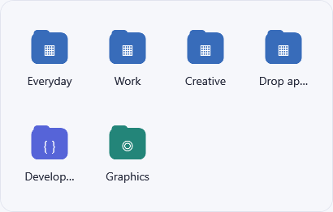
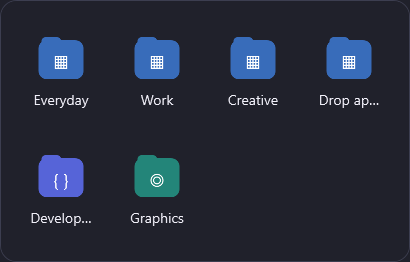
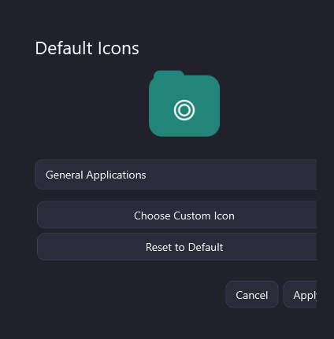
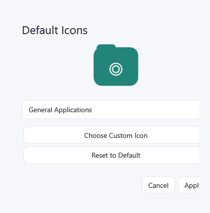
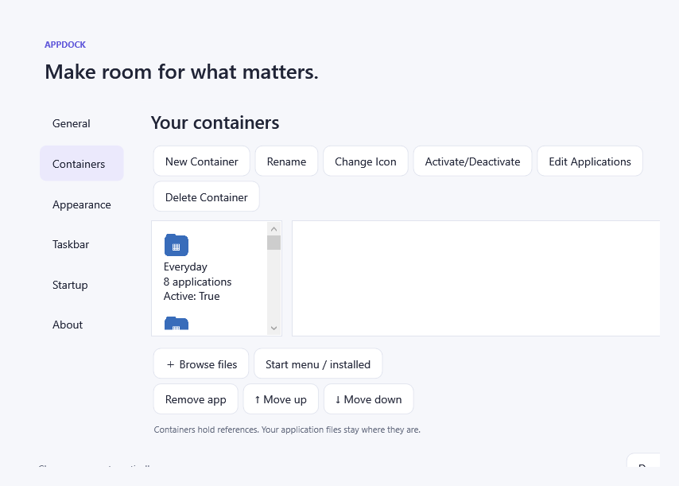
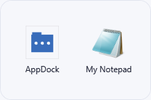
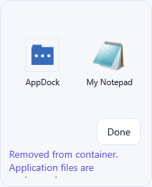

# AppDock Phase 2A implementation report

Validated on 22 October 2026, Windows build 26300, .NET 10, Release configuration. Development branch: `codex/appdock-phase-2a`, created from the initially clean `main` baseline. No push or release package.

## Delivered behavior

- Official AppDock window, tray, settings, About, executable metadata, product icon and current documentation. Internal AppBox project names, schema names, legacy IPC and main taskbar identity remain compatible.
- Compact content-sized container popup, optional app names, 24–64 pixel application icons, bounded scrolling, Light/Dark themes, Escape/focus dismissal and immediate launching. Routine custom approval UI and approval callbacks were removed; target/argument/directory security validation remains.
- Empty-space container context menu and per-application actions; edit-only Done/status strip, external imports, application reordering and save rollback. Context menus and owned dialogs protect focus dismissal. Editing inactive containers from the manager preserves their contents.
- Container Manager with icons, names, app counts, activation state, CRUD, activation/deactivation, Edit Applications and Change Icon. Deletion requires confirmation and removes references only.
- Single AppDock category overview and Multiple AppDocks GUID-addressed launchers. One popup is reused, with matching window identity/icon/relaunch metadata for the addressed container.
- Persistent default/built-in/custom icon definitions. Eight locally drawn category icons, fallback, live preview, reset and `.ico`/`.png`/`.exe`/`.lnk` imports. Alpha-preserving multi-resolution ICOs persist under the configuration directory. Source deletion does not break imported icons.
- Stable `<guid>.lnk` paths and `AppDock.Container.<guid>` AppUserModelIDs, persistent icon references, duplicate prevention and isolated icon choices. Deactivation preserves data, generated shortcuts and resources. Deleted/inactive launcher requests do not route to a different container.

## Migration and compatibility

On first run, AppDock copies the exact legacy `%LOCALAPPDATA%\AppBox\settings.json` bytes into `%LOCALAPPDATA%\AppDock\settings.json` through a staging file only if the destination is absent. Original files are never removed or changed. Existing AppDock settings win. Inaccessible paths/copy failures surface an error; invalid configuration is preserved for recovery. Folder/app GUIDs, order, serialized layout enums and settings remain readable. New activation/icon fields have safe defaults.

`AppBox.App.exe` is now a forwarding launcher beside `AppDock.exe`, retaining old shortcut target names and both old `--folder` and new `--container` routing. Compatibility requires upgrading in place or manually retargeting shortcuts to a relocated installation. Exit the original AppBox process before upgrading. Existing startup registration is recognized; explicitly updating the startup preference consolidates the owned Run entry under AppDock.

## Validation results

`dotnet build AppBox.sln -c Release`: passed, zero warnings/errors.

`dotnet run --project tests/AppBox.Tests -c Release --no-build`: **51 passed, 0 failed** (39 baseline cases retained/updated plus 12 Phase 2A cases). Coverage includes migration precedence/exact-data retention, activation/icon persistence, custom PNG/ICO/EXE/LNK loading, transparency, missing/invalid sources, generic fallback, reset with stable IDs, seven-frame persistent ICOs, native shortcut AppUserModelID, shortcut updates/no duplicates, multiple-container isolation, mode switching, direct launching, failed-save rollback and deletion safety.

`scripts/validate.ps1 -Smoke`: passed on genuine Windows WPF windows. Production launch dispatch used a harmless test executable; secondary processes exercised both current and legacy launchers. Diagnostics verified routing, launch dismissal, focus dismissal, edit focus retention across three cycles, real FileDrop imports, reorder/rename/remove persistence, bounded large-container scrolling, container-context Edit action, custom PNG import, Light/Dark rendering and container window icon/title. User configuration, startup registration and pins were not modified.

Rendered captures were visually inspected. The computer-use skill was attempted, but its runtime could not start: the sandbox launcher failed while enumerating unrelated BitLocker-locked F:. Therefore physical Explorer drag gestures, actual taskbar pin/unpin/grouping and Windows icon-cache refresh were **not performed or certified**. The app's WPF render diagnostics provide client-area captures, not desktop/taskbar screenshots.

## Windows taskbar limitations

Pinning requires the user's Windows Pin to taskbar action. AppDock exposes the generated shortcuts in Settings → Taskbar. It never modifies Explorer taskband internals or pinned shortcut files. Windows may keep a cached/copied pin label or icon; manual unpin/repin may be necessary. Exact pinned-button coordinates are unavailable through the APIs used here; positioning uses the pointer/taskbar edge, monitor work area and DPI. Existing pins to another installation path need manual retargeting. These limitations are documented in [Windows integration](windows-integration.md).

## Reviewed captures

Raw diagnostic summaries and layout metrics are retained alongside these captures. The final merge commit is reported in the delivery response; use `git log -1 --merges main` to inspect it.
