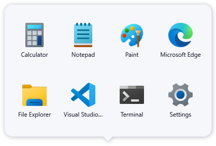
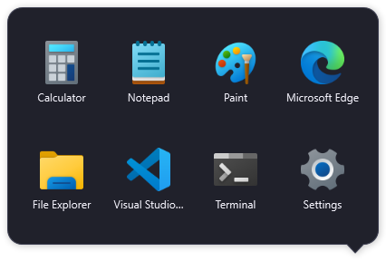
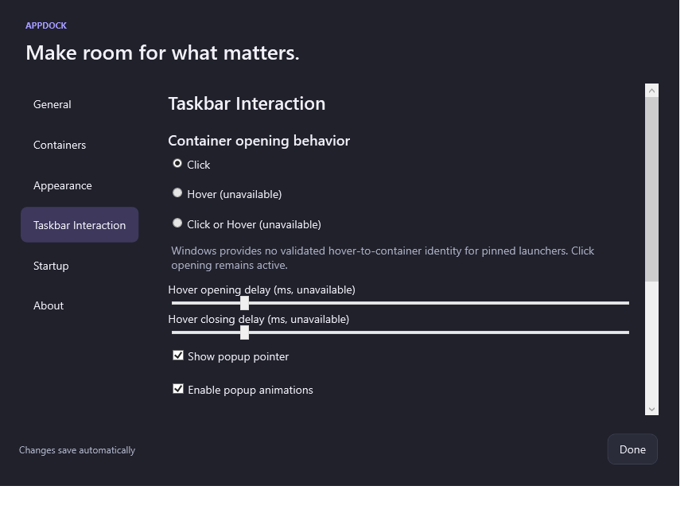
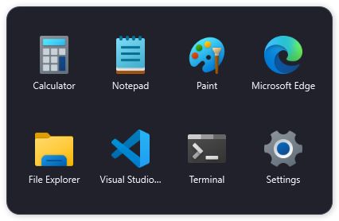

# AppDock Phase 2B technical report

Validation date: 22 October 2026. Baseline: `6aad3ee66afde56f7292d54e5381e7c4635060a4`. Feature branch: `codex/appdock-phase-2b`, created from a clean `main`. No push or release package.

## Delivered implementation

**Jump Lists.** The main `AppBox.Desktop` AppUserModelID and each stable `AppDock.Container.<guid>` receive AppDock Settings, Edit Container and Manage Containers tasks through native `ICustomDestinationList`. Every task is an `IShellLinkW` with action arguments, optional container GUID, working directory, persistent icon and `PKEY_Title`. `SetAppID` runs before `BeginList`, so a container's tasks belong to its matching shortcut/window identity rather than only the process identity. Failed publication is nonfatal; unfinished sessions abort and COM objects are released. Windows Explorer context menus and taskbar internals are not modified.

**Routing.** `--settings`, `--edit-container`, and `--manage-containers` use the existing primary process through current-user/session named-pipe IPC. Versioned command messages coexist with Phase 2A bare-GUID activation. `--container` and legacy `--folder` remain supported. Invalid/ambiguous commands are rejected. Explicit missing IDs never fall back to another container. Settings and management reuse the existing settings window, switch section and select the requested container. Edit opens the correct active container in Edit Mode; a main Edit request with no active container opens management. Phase 2A container icon/shortcut/configuration behavior remains intact.

**Popup pointer.** One WPF window renders a union of rounded body and triangular pointer with a shared fill, border and shadow. Transparent margins reserve space for the triangle and shadow. On a bottom taskbar, the pointer uses cursor x when the cursor is over that taskbar; otherwise it centers beneath the popup. It clamps away from rounded corners and uses the target monitor's working area and actual window DPI. This is explicitly approximate alignment, not a measured pinned-button rectangle. The pointer is hidden for top/side taskbars and can be disabled in Settings.

**Lifecycle.** Closed, Opening, Open, HoverOpen (reserved), Editing and Closing are explicit states. Repeated presentation does not restart the opening animation. Generation tokens prevent stale animation completions from reopening a closed popup or overriding Edit Mode. Editing and owned dialogs/context menus protect focus dismissal. Escape retains Phase 2A behavior: leave editing, then dismiss. Shutdown cancels animation state, clears drag feedback and unsubscribes model changes. No hover timers or global input hooks exist.

**Settings.** Taskbar Interaction offers Click, disabled/unavailable Hover and Click or Hover choices, disabled reserved opening/closing delay controls, Show popup pointer and Enable popup animations. Click remains the effective/default mode. Delays default to 400 ms, persist and clamp to 100–2000 ms. Loading an unsupported hover mode safely falls back to Click. Disabled options do not claim working hover support.

## Hover feasibility result

1. **APIs investigated:** ICustomDestinationList/AppUserModelID, ITaskbarList3, DWM iconic thumbnail/live-preview messages, UI Automation identification properties, and Shell_NotifyIconGetRect/notification-area callbacks. Official references are linked in [Windows integration](windows-integration.md).
2. **Technical limitation:** Jump Lists provide actions and IDs, not per-pinned-shortcut hover events. DWM messages request thumbnail/preview imagery; that is not the actual interactive container. UI Automation has no documented stable Explorer button-to-container GUID contract: names are localized/nonunique and AutomationId support/stability is not guaranteed. Notification-icon events/rectangles apply to owned tray icons, not independently pinned containers. No validated supported mechanism was found for the required reliable hover-to-container mapping.
3. **Tested fallback:** Click-to-open and explicit Jump List command routing show the real interactive WPF popup. Production dispatch, application launching, dismissal, editing and repeated activation passed diagnostics. Hover requests cannot schedule opening or mutate the click/edit lifecycle. Delay range/persistence and unsupported-hover cancellation guards are tested; there is no claim of a working hover delay timer or a physical taskbar-to-popup hover transition.
4. **Recommended next step:** Keep click activation in production. Revisit hover if Microsoft provides a stable per-launcher identity/event contract. An AppDock-owned dock or notification-area UI could provide owned pointer events, but would require an explicit product decision and would not constitute hover support for independent taskbar pins.

No Explorer-name guessing, accessibility-tree polling, global keyboard/mouse interception, injection, or thumbnail simulation was added.

## Validation

`dotnet build AppBox.sln -c Release`: **passed, zero warnings/errors**.

Regression runner: **63 passed, 0 failed**. All 51 Phase 2A/baseline cases pass. Twelve new cases cover task labels/command/ID round-trips, legacy activation, malformed commands, inactive/missing resolution, native explicit-AppID Jump List publication/replacement, single-instance IPC, pointer clamping/fallback/visibility, fractional-DPI conversion with negative monitor origins, lifecycle/stale-completion cancellation, unsupported-hover guards and configuration/delay persistence.

`scripts/validate.ps1 -Smoke`: **passed** with genuine WPF windows, native Shell APIs, actual secondary processes and a harmless launch-probe executable. It verifies Settings/Manage/Edit routing, correct IDs, reuse/retargeting of the existing settings window, one popup after repeated activation, and successful diagnostic Jump List publication. Phase 1C/2A import/edit/icon/launch/focus regressions still pass. Launch-probe marker publication is now atomic to eliminate an observed test write/read race.

An isolated Release output option (`-Isolated`) was also exercised while an existing application held normal output files open. Diagnostics have their own IPC scope and temporary configuration, preserving the user's running application/configuration. Temporary diagnostic Jump Lists use distinct AppIDs and are removed afterward; production pins/startup settings are not changed. The compatibility launcher copy target resolves the referenced project's actual output directory, supporting normal and isolated builds.

### Rendering and monitor evidence

Pointer Light/Dark center and clamped-right-edge captures were visually reviewed on both available displays using explicit diagnostic anchors on the actual monitor geometry:

| Display | Bounds | Work area | Actual captured DPI |
| --- | --- | --- | --- |
| 0 | x=-2560, y=-454, 2560×1440 | 2560×1392 | 96 |
| 1 | x=0, y=0, 1920×1080 | 1920×1032 | 96 |

The pointer-off setting and Taskbar Interaction settings were also rendered/reviewed. Unit tests cover 100%, 125%, 150% and 200% coordinate conversion; the available displays were both at 100%, and no system scaling was changed. Captures are WPF window renders, not desktop/taskbar photographs. The anchors intentionally exercise the fallback geometry and are not evidence of exact pinned-button alignment.

### Practical interaction limits

The computer-use skill/runtime was attempted. Its JavaScript kernel could not start because the sandbox launcher failed while enumerating unrelated BitLocker-locked F:. Consequently **actual Windows taskbar right-click command presentation, pin/unpin, physical taskbar-to-popup mouse movement, and hover opening were not performed or certified**. Successful native list publication and direct secondary-process command execution are automated integration evidence, not substitutes for those physical tests.

Windows owns Jump List availability/presentation, policy, caching and the identity of existing pins. Old or inferred-identity pins may need manual repinning. An already running Phase 2A application must be exited before the upgraded primary can handle the new command protocol. Normal click launching remains the supported fallback. Physical menu validation remains a manual acceptance item.

## Captures

Raw monitor geometry, layout metrics and all phase smoke summaries are retained alongside the captures. The final merge commit is reported in the delivery response; `git log -1 --merges main` identifies it after the merge.
