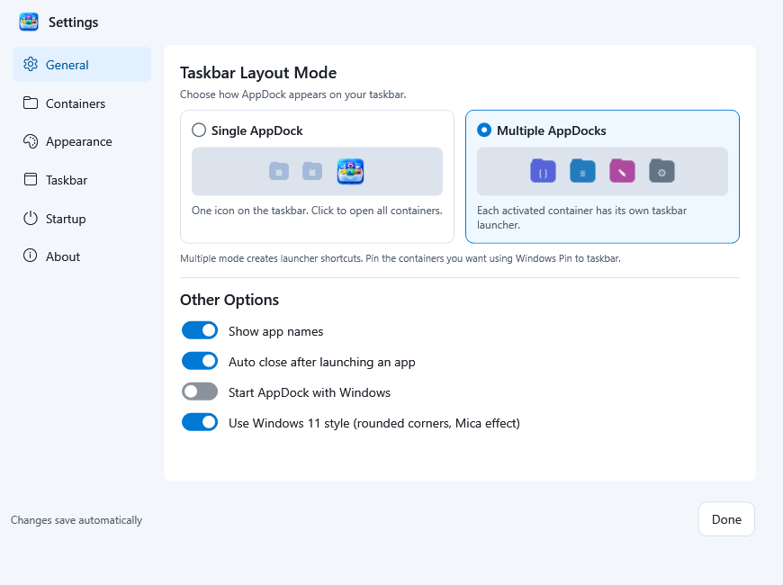
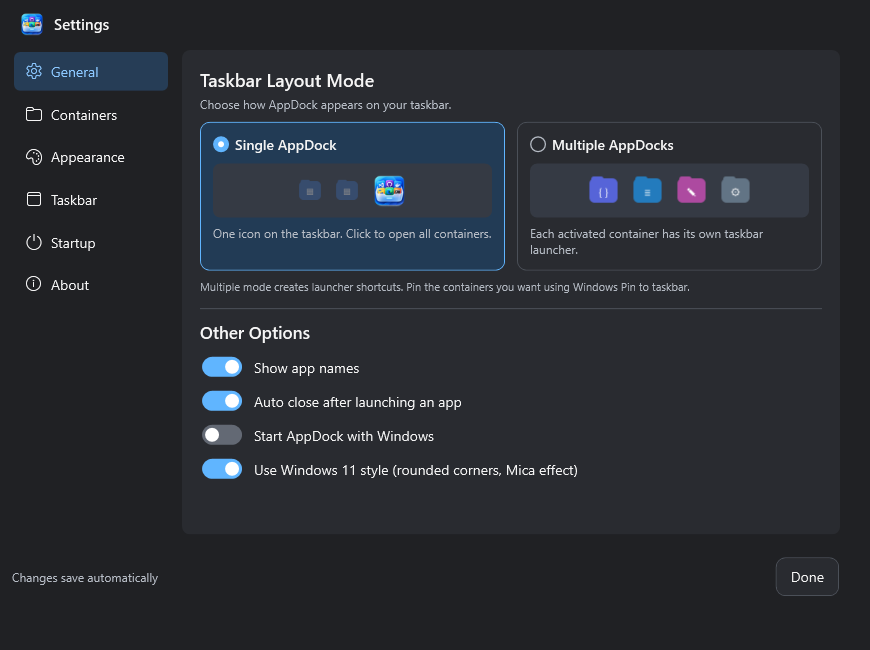
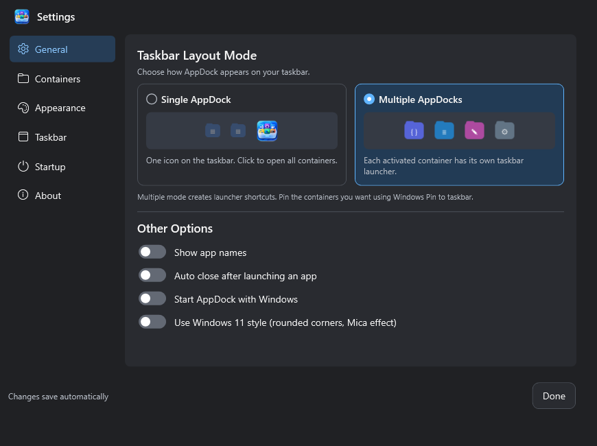
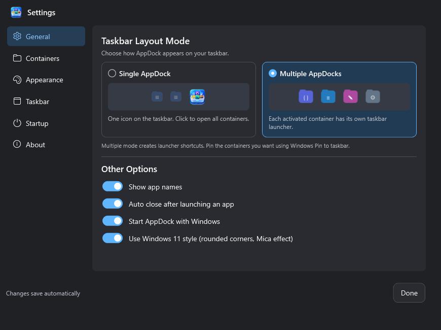
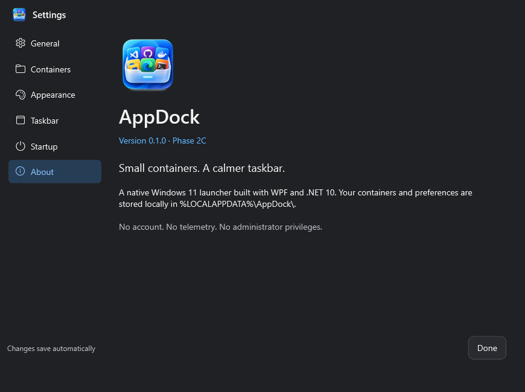

# AppDock Phase 2C implementation report

Validated on 22 October 2026, Windows build 26300, .NET 10, Release. Baseline: `3367ce961fdb18c288f9f379a1e768f0c15da609`. Feature branch: `codex/appdock-phase-2c`. No push or release package.

## Official icon integration

The supplied `AppDock_Icon_Pack/Windows/AppDock.ico` replaces the placeholder unchanged. It contains 16, 24, 32, 48, 64, 128 and 256-pixel frames. Source pack, project resource and Release output ICO have the same SHA-256:

`89BE77986E8FFE10FB64280183F155D09A199E93E5F9D7BFFAAC0B6FF92AB53B`

The ICO is embedded in both AppDock.exe and the legacy forwarding executable through their ApplicationIcon settings, embedded as a WPF resource for owned window icons, and copied beside AppDock.exe for persistent Shell icon references. The selected 32/64/128-pixel PNG resources are embedded under Resources/Branding. Settings and About show official artwork; previews use the higher-resolution UI image with high-quality downsampling. No runtime branding path refers to the original development pack.

A stable main `Launchers/AppDock.lnk` uses the official icon and retained main AppUserModelID. Main/window relaunch branding and Jump List action icons use the product ICO. Container-specific launcher/window/custom icons remain unchanged. Shortcut creation failures report nonblockingly instead of preventing ordinary launching. The original source pack remains untouched and is ignored by Git; only necessary project assets are tracked.

Windows can cache an old executable/pin icon. Exit the previous instance and start the rebuilt AppDock; manually unpin/repin the main shortcut if needed. No taskbar-cache deletion, Explorer injection or unsupported pin modification is performed.

## Reference-based General page

The supplied screenshot is retained as [approved-reference.png](phase-2c-screenshots/approved-reference.png). The redesign follows its visual hierarchy: compact icon navigation, Taskbar Layout Mode heading/subtitle, two side-by-side selectable cards, graphical taskbar previews, blue selected border/radio/background, divider, and four compact toggle rows.

Reusable native WPF controls provide LayoutSelectionCard, AppDockToggleSwitch and TaskbarPreview. A card's complete title/preview/description surface belongs to its RadioButton; the complete toggle row belongs to its CheckBox. Native keyboard and accessibility semantics are retained. Switches use white thumbs, blue enabled tracks, neutral disabled tracks and subtle 120 ms movement. Themes use centralized resources; primary/muted text and selected navigation text have automated contrast checks. No third-party UI or icon package was added.

Selection wraps the existing serialized LayoutMode rather than creating a second setting. The four options wrap ShowApplicationNames, CloseAfterLaunch, StartWithWindows and additive UseWindows11Style. Preferences save through the existing service, restore on restart and roll back with an inline error if saving fails. The Startup page binds the same ViewModel property. Tests inject a startup service, so validation does not change the user's logon registration. The production setter still invokes the existing Windows startup service.

The production launch path now honors the existing CloseAfterLaunch preference; it had previously dismissed unconditionally. Default true behavior is preserved. A real probe launch verifies that disabling the switch keeps the popup open. Path, argument, working-directory and Windows security behavior remain unchanged.

Navigation remains General, Containers, Appearance, Taskbar, Startup and About. The Taskbar page retains the Phase 2B interaction controls, and old internal section aliases still route there. Application icon sizing moved to Appearance to keep General aligned with the reference. Existing container settings, activation and application order remain intact.

### Intentional differences from the reference

- AppDock/Containers replaces the reference's obsolete AppBox/Folders wording, and the official supplied artwork replaces its sample cube/product image.
- The existing 870×650 default window and autosave/Done footer are retained rather than copying the reference's smaller outer window dimensions.
- A concise manual-pinning explanation appears beneath the cards; selecting Multiple does not imply automatic pinning.
- Multiple preview icons reuse built-in category artwork rather than adding dependencies or copying third-party app images from the screenshot.
- When the working area is smaller at high scaling, Settings is constrained to that monitor and the page scrolls. The controls remain reachable rather than forcing the entire page into a clipped viewport.

## Windows 11 style behavior

The option uses documented DWM corner/dark-mode/system-backdrop attributes and client-frame extension. The full supported backdrop API is gated to Windows 11 build 22621 or later. The normal WPF window and composition target become transparent only after successful calls and read-back of the requested system backdrop. Disabled/unavailable paths restore a solid dynamic theme surface and remove the extended frame/backdrop. Unsupported Windows versions disable the option; unavailable material has a concise fallback explanation. The layered launcher retains custom popup geometry and does not claim a native Mica backdrop.

On this machine, native read-back reported **RoundedCornersApplied=True** and **SystemBackdropApplied=True**. Disabling the option restored the fallback state. This verifies accepted native configuration; Windows may still choose a solid material fallback according to its own conditions. Official API references and caveats are recorded in [Windows integration](windows-integration.md).

## Validation results and limits

- `dotnet build AppBox.sln -c Release`: **passed, 0 warnings, 0 errors**.
- Regression runner: **73 passed, 0 failed**. All 63 baseline cases remain passing; 10 new cases cover layout/data preservation, toggle reload, startup initialization/rollback, failed saves, unsupported style, legacy defaults, embedded ICO/PNG frames, main shortcut icon/native identity stability and theme contrast.
- `scripts/validate.ps1 -Smoke`: **passed**. WPF diagnostics hit-test card title/preview/description regions and select through native automation peers; exercise all toggle bindings and thumb endpoints; verify unchanged container/app/icon/activation data; render both themes and mode selections; check native style state; and execute a real auto-close-off launch probe. All earlier phase diagnostics pass.
- Captures for 125%, 150% and 200% use simulated DIP-constrained window sizes and matching export pixel density. Top/bottom renders demonstrate scrolling at constrained height. The available monitors remained at 96 DPI; actual OS scaling was not changed or physically tested.
- Computer-use was attempted, but its kernel failed to start because the sandbox launcher could not enumerate unrelated BitLocker-locked F:. Therefore an actual Windows taskbar showing the refreshed icon, native caption-icon capture, and compositor-rendered Mica capture remain **unverified**. WPF content captures cannot include DWM's own material and are rendered over the matching theme surface. No synthetic taskbar evidence is presented as a real Windows capture.

The source artwork, settings client branding, About artwork, full-card selection, switch positions, theme states and constrained captures were visually reviewed against the supplied reference. The remaining practical checks are manual taskbar cache/repinning and compositor/physical-scaling inspection.

## Reviewed captures

Additional mode variants, simulated scale top/bottom views and raw diagnostic summaries are retained alongside the images. The final merge commit is reported in the delivery response; use `git log -1 --merges main` after the merge.
